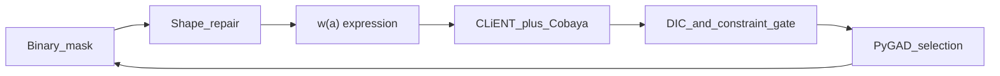

# GA discovery of dynamical dark energy \(w(a)\)

Genetic-algorithm search for dark-energy equations of state using **CLASS**, **Cobaya**, and **CLiENT**, with **DIC** fitness and a posterior-constraint gate on Pantheon+SH0ES + DESI DR2.

This repository is the paper / employer showcase: full runnable pipeline (science code + Docker/Kubernetes/HPC), curated figures, and documentation of the method—not a dump of every HPC run directory.

| | |
|---|---|
| **Author** | Rebecca Briffa |
| **License** | MIT |
| **Stack** | PyGAD · CLASS · Cobaya · CLiENT · TensorFlow · Docker · Kubernetes |

---

## What this does

1. Encode candidate \(w(a)\) as a **binary mask** over coefficient × shape pairs.
2. Repair masks to **unique shapes**, **2–5 active terms**, with a constant \(w_0\) anchor.
3. Fit each structure with CLiENT (emulator) + Cobaya likelihoods.
4. Rank by **DIC**; **fail** models whose free DE coefficients are unconstrained vs the prior.
5. Evolve the population with PyGAD; optionally run a long post-GA chain on the winner.



---

## Repository layout

```
GA_wcdm_paper/
├── README.md                 # this file
├── LICENSE / CITATION.cff
├── class/                    # CLASS + GA Python pipeline
│   └── scripts/              # chromosome, fitness, GA driver, runners
├── docker/                   # image, entrypoint, K8s, Slurm helpers
├── lcdm_baseline/            # ΛCDM SN+DESI reference runs
├── results/                  # curated summaries + presentation figures
└── docs/                     # pipeline, architecture, shapes, fitness, HPC, skills
```

Live HPC trees and large `gen_*` run folders stay outside this repo (see `.gitignore`).

---

## Quick start (Docker)

```bash
# 1. Build (from repo root; requires Cobaya data prep — see docs/HPC_DEPLOYMENT.md)
docker build -f docker/Dockerfile -t ga-wdm:latest .

# 2. Run with paper defaults (DIC, pop 20, 40 gens)
mkdir -p runs
docker run --rm --gpus all \
  --env-file docker/env.example \
  -v "$PWD/runs:/work" \
  ga-wdm:latest run-ga
```

Kubernetes (namespace `cosmic-learning`):

```bash
kubectl apply -f docker/k8s/ga-config.yaml
kubectl apply -f docker/k8s/ga-pod-interactive.yaml
# then: kubectl exec -it ga-wdm-pod -n cosmic-learning -- bash
# inside: run-ga   (or follow docker/k8s/README.md)
```

Local / Slurm paths: [docs/HPC_DEPLOYMENT.md](docs/HPC_DEPLOYMENT.md), [docker/CLUSTER.md](docker/CLUSTER.md).

---

## Paper defaults

| Setting | Value | Env / ConfigMap |
|---------|-------|-----------------|
| Fitness | DIC | `GA_FITNESS_METRIC=dic` |
| Constraint gate | on | `GA_REQUIRE_CONSTRAINED=1` |
| Unconstrained rule | 95% CI ≥ 85% of prior width | `GA_UNCONSTRAINED_FRAC=0.85` |
| Population / generations | 20 / 40 | `GA_POP_SIZE`, `GA_NUM_GENERATIONS` |
| Shapes | 20 polynomial / mid-\(a\) | `chromosome.SHAPE_POOL` |
| Active terms | 2–5 unique shapes | `MIN_ACTIVE_PAIRS` / `MAX_ACTIVE_PAIRS` |
| Likelihood | CLiENT + SN+DESI | `GA_LIKELIHOOD=client`, `GA_COBAYA_CONFIG=sn_desi` |

Raw gene space is \(20\times20=400\) bits; repair + unique-shape rules reduce the searchable catalogue to on the order of **~5×10³** distinct models (combinatorial count over shapes with 2–5 actives, constant on).

---

## Documentation

| Doc | Contents |
|-----|----------|
| [docs/PIPELINE.md](docs/PIPELINE.md) | End-to-end data flow |
| [docs/ARCHITECTURE.md](docs/ARCHITECTURE.md) | Modules and process boundaries |
| [docs/SHAPES_AND_ENCODING.md](docs/SHAPES_AND_ENCODING.md) | Genes, shapes, repair |
| [docs/FITNESS_AND_SELECTION.md](docs/FITNESS_AND_SELECTION.md) | DIC, BIC, unconstrained gate |
| [docs/HPC_DEPLOYMENT.md](docs/HPC_DEPLOYMENT.md) | Docker, GHCR, K8s, Slurm |
| [docs/RESULTS.md](docs/RESULTS.md) | How to read `GA_summary` and figures |
| [docs/SKILLS.md](docs/SKILLS.md) | Skills demonstrated (employer-facing) |

---

## Citation

See [CITATION.cff](CITATION.cff). If you use this code in a paper, cite the software and the CLASS / Cobaya / CLiENT / DESI / Pantheon+ references as appropriate.

---

## Related

The working HPC checkout used during development is separate from this showcase tree so run artefacts never pollute the public GitHub history.
